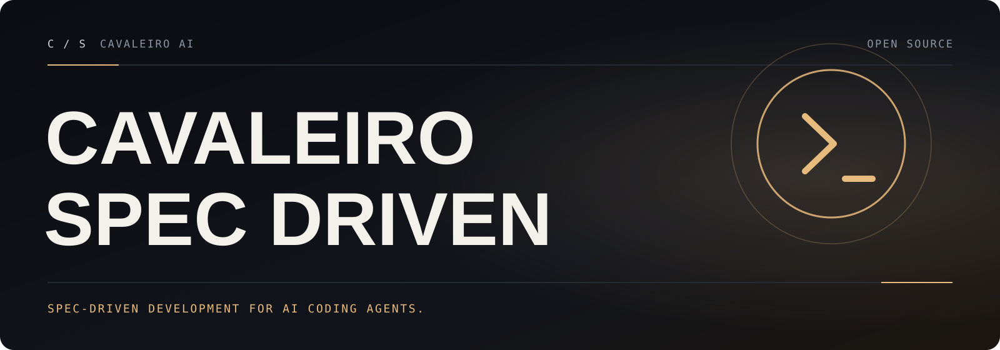

**English** · [Português (Brasil)](README.pt-BR.md)

<a id="top"></a>

<p align="center">
  
</p>

<h1 align="center">Cavaleiro Spec Driven</h1>

<p align="center">
  <em>Build with a spec, fix a bug, or assess an idea — with your coding agent.</em>
</p>

<p align="center">
  <a href="https://github.com/cavaleiro-ai/cavaleiro-spec-driven/actions/workflows/test.yml"></a>
  <a href="LICENSE"></a>
  <a href="CHANGELOG.md"></a>
</p>

Cavaleiro Spec Driven is a toolkit that gives AI coding agents structured processes, reusable templates, and documented outcomes. You install the `specify` CLI, scaffold a project for your agent, and run processes such as Spec-Driven Development (SDD) through agent skills like `/speckit-specify` and `/speckit-plan`.

Cavaleiro Spec Driven is maintained by [Cavaleiro AI](https://github.com/cavaleiro-ai). It keeps every feature of the original project (see [License](#license)), adds verified security, robustness, and Windows fixes, and keeps every command name, file layout, and package name compatible with the original project.

- [What Cavaleiro Spec Driven adds](#what-cavaleiro-spec-driven-adds)
- [Install](#install)
- [Choose your process](#choose-your-process)
- [Compatibility](#compatibility)
- [Documentation](#documentation)
- [License](#license)

## What Cavaleiro Spec Driven adds

Everything from the original project at commit `c6a4c18`, plus the following (details and evidence in the [changelog](CHANGELOG.md#cavaleiro-spec-driven-100--2026-10-17) and the [engineering report](docs/cavaleiro/ENGINEERING.md)):

- **Safer archive handling:** a tiny tar.gz can no longer allocate gigabytes or crash the CLI with `RecursionError` through chained extended headers, and downloads cut short of their `Content-Length` are rejected instead of being installed half-written.
- **Clean network errors:** connection resets, read timeouts, and incomplete reads during `extension add --from`, `preset add --from`, and catalog fetches report an error instead of a traceback.
- **A friendlier `specify init`:** a failed init no longer leaves a half-built directory that blocks the retry; `init --here --force` keeps your `feature_numbering`; error text with `[brackets]` renders literally.
- **Windows fixes:** the PowerShell scripts work in project paths that contain `[` `]`, and `specify self upgrade` recognizes `uv tool` installs (`%APPDATA%\uv\tools`).
- **A fix for a bug in the original project:** `GIT_BRANCH_NAME` naming the current branch no longer breaks every `/speckit-specify` run (original issue #5003) in Bash, PowerShell, and Python.
- **Fork-aware upgrades:** opt-in `SPECIFY_UPGRADE_REPOSITORY=owner/repo` makes `specify self check/upgrade` follow a fork instead of silently replacing it with the original project's release.
- **Documentation in Portuguese:** [README.pt-BR.md](README.pt-BR.md) and a complete [Portuguese guide](docs/cavaleiro/GUIA-PT-BR.md).
- **Fork safety:** publishing, deployment, and bot workflows inherited from the original project are parked in [`.github/workflows-disabled/`](.github/workflows-disabled/README.md).

<a id="install"></a>

## Install

You need **Python 3.11+**, **[uv](https://docs.astral.sh/uv/)** (or pipx), and a supported AI coding agent on Linux, macOS, or Windows. Git is optional (needed only for the git extension).

Install Cavaleiro Spec Driven from this repository and create a project:

```bash
uv tool install specify-cli --from git+https://github.com/cavaleiro-ai/cavaleiro-spec-driven.git
specify init my-project --integration copilot
cd my-project
```

The same commands work in Windows PowerShell. Interactive `specify init` asks which script variant to install; non-interactive runs default to PowerShell on Windows and Bash elsewhere. Pass `--script sh`, `--script ps`, or `--script py` to choose explicitly.

Other ways to run it:

```bash
# One-off run without installing
uvx --from git+https://github.com/cavaleiro-ai/cavaleiro-spec-driven.git specify init my-project --integration claude

# pipx
pipx install git+https://github.com/cavaleiro-ai/cavaleiro-spec-driven.git

# Check the install and your agents
specify version
specify check
```

> [!IMPORTANT]
> The package name is still `specify-cli`, so `uv tool install specify-cli` **without** `--from` (or `pip install specify-cli`) installs **the original project** from PyPI, not Cavaleiro Spec Driven. See [Compatibility](#compatibility).

Replace `copilot` with your [integration key](docs/reference/integrations.md) (for example `claude`, `codex`, `gemini`, `cursor-agent`, `opencode`, or `generic` with `--integration-options="--commands-dir .myagent/commands"`). Already have code? Follow the [existing-project guide](docs/guides/existing-projects.md).

Now **launch your coding agent in the project directory** and choose a process below. Invoke each `/speckit-*` **skill in your agent's chat**, one at a time, and review the result before continuing. These are agent skills, not terminal commands; other agents may use [different invocation syntax](docs/reference/integrations.md).

## Choose your process

| What you need | Process | Outcome |
| --- | --- | --- |
| Build a feature or application | [Spec-Driven Development](#spec-driven-development) | A specification carried through planning, implementation, and convergence |
| Diagnose and repair broken behavior | [Bug fixing](#bug-fixing) | An assessed cause, scoped fix, and recorded verification |
| Decide whether an idea deserves investment | [Idea assessment](#idea-assessment) | An evidence-backed go, clarify, or stop decision |
| Adopt or create a different process | [Customize](#customize-or-bring-your-own-process) | A process adapted or assembled from reusable primitives |

### Spec-Driven Development

Define **what and why** before deciding **how**. SDD turns requirements into a specification, a technical plan, and actionable tasks, then guides implementation against those artifacts. **Constitution once per project; specify → plan → tasks → implement → converge per feature.**

```text
/speckit-constitution Create principles focused on code quality, testing, and maintainability.
/speckit-specify Build a photo organizer with albums grouped by date and a tile preview of each album.
/speckit-plan Use Vite with vanilla JavaScript. Keep images local and store metadata in SQLite.
/speckit-tasks
/speckit-implement
/speckit-converge
```

Repeat **implement → converge** until convergence reports **Converged**. Add `/speckit-clarify`, `/speckit-checklist`, and `/speckit-analyze` when you need extra quality gates. [SDD walkthrough](docs/quickstart.md) · [Command reference](docs/reference/agentic-sdd.md)

### Bug fixing

Keep diagnosis, repair, and verification separate. In the terminal, from the project directory:

```bash
specify extension add bug
```

Then, in your agent's chat:

```text
/speckit-bug-assess "Submitting an empty password crashes the login form." slug=login-crash
/speckit-bug-fix slug=login-crash
/speckit-bug-test slug=login-crash
```

Reports live in `.specify/bugs/login-crash/`. [Bug-fixing walkthrough](docs/guides/bugfix.md) · [Command reference](docs/reference/agentic-bugfix.md)

### Idea assessment

Gather evidence before committing to an idea, even in a project with no source code:

```bash
specify extension add assess
```

```text
/speckit-assess-intake "Let users work offline and sync when they reconnect." slug=offline-mode
/speckit-assess-research slug=offline-mode
/speckit-assess-define slug=offline-mode
/speckit-assess-shape slug=offline-mode
/speckit-assess-decide slug=offline-mode
```

Artifacts live in `.specify/assessments/offline-mode/`, ending in a **go / needs-clarification / kill** decision. [Assessment walkthrough](docs/guides/assessment.md) · [Command reference](docs/reference/agentic-assessment.md)

### Customize or bring your own process

| Capability | Mechanism |
| --- | --- |
| Connect to or switch between coding agents | [Integrations](docs/reference/integrations.md) |
| Add a command, quality gate, or complete process | [Extensions](docs/reference/extensions.md) |
| Adapt templates, commands, terminology, or methodology | [Presets](docs/reference/presets.md) |
| Override a template for one project | [Project-local overrides](docs/guides/customization.md) |
| Automate prompts, commands, gates, and shell tasks | [Workflows](docs/reference/workflows.md) |
| Install a curated setup for a role or team | [Bundles](docs/reference/bundles.md) |
| Discover or host component catalogs | [Catalogs](docs/reference/catalogs.md) |
| Access private catalogs and downloads | [Authentication](docs/reference/authentication.md) |
| Work offline or behind a firewall | [Air-gapped installs](docs/install/air-gapped.md) |
| Inspect which layer supplies a command, template, or script | [Artifact inventory](docs/reference/artifacts.md) |

Catalog listings are not audits or endorsements; review community source code before installing or running it.

## Compatibility

Cavaleiro Spec Driven renames the **project**, not the **identifiers**, so existing projects, scripts, and docs keep working:

- **The command is still `specify`** and the Python package is still **`specify-cli`** (version `1.2.2.dev0`, inherited from the original project). `specify version` reports that package version; the Cavaleiro release is **1.0.0**.
- **Agent commands keep their names** — `/speckit.*` and `/speckit-*` skills, extension commands such as `speckit.git.feature`, and template placeholders are unchanged.
- **Project layout and configuration are unchanged** — `.specify/`, `init-options.json`, `integration.json`, extension/preset/workflow manifests, and all environment variables (`SPECIFY_INIT_DIR`, `SPECIFY_FEATURE`, `SPECKIT_CATALOG_URL`, `SPECKIT_PRESET_CATALOG_URL`, `GH_TOKEN`, …). A project created by the original project works here and vice versa.
- **Runtime endpoints still point to the original project.** Nothing was silently repointed:
  - Extension, preset, integration, workflow, step, and bundle **catalogs** are fetched from `raw.githubusercontent.com/github/spec-kit/main/…`. Override them with `SPECKIT_CATALOG_URL`, `SPECKIT_PRESET_CATALOG_URL`, `SPECKIT_INTEGRATION_CATALOG_URL`, `SPECKIT_WORKFLOW_CATALOG_URL`, and `SPECKIT_STEP_CATALOG_URL`, or with per-project catalog files under `.specify/` (see [Catalogs](docs/reference/catalogs.md)).
  - **`specify self check` / `specify self upgrade`** query `api.github.com/repos/github/spec-kit/releases/latest` and reinstall from `git+https://github.com/github/spec-kit.git` — i.e. running `self upgrade` replaces Cavaleiro Spec Driven with the **original project's** release. Set `SPECIFY_UPGRADE_REPOSITORY=owner/repo` to follow a fork that publishes its own release tags, or reinstall with the command in [Install](#install).
  - The CLI has **no telemetry**. Network calls happen only for catalog lookups, downloads you request, and `self check`/`self upgrade`.
- **Bundled extensions** keep their IDs; `git` (1.0.2) and `agent-context` (1.0.3) have Cavaleiro version bumps because their scripts changed.
- **Inherited docs.** Pages under [`docs/`](docs/index.md) come from the original project; install commands there that name `github/spec-kit` install the original project. The original project's translated READMEs are in [`docs/original-i18n/`](docs/original-i18n/README.md), and its newsletters are in [`newsletters/`](newsletters/).

## Documentation

- [Installation](docs/installation.md), [upgrade](docs/upgrade.md), and [local development](docs/local-development.md)
- [CLI reference](docs/reference/overview.md), [core commands](docs/reference/core.md), and [MCP server](docs/reference/mcp.md)
- [SDD philosophy](docs/concepts/sdd.md), [full methodology](spec-driven.md), and [evolving existing specs](docs/guides/evolving-specs.md)
- [Monorepos](docs/guides/monorepo.md) and the [history of the original project](docs/history.md)
- **Português:** [README.pt-BR.md](README.pt-BR.md) and the [complete guide](docs/cavaleiro/GUIA-PT-BR.md)
- **Engineering:** [architecture, baseline, findings, and verification](docs/cavaleiro/ENGINEERING.md)

## Support and contributing

[Report a bug or request a feature](https://github.com/cavaleiro-ai/cavaleiro-spec-driven/issues/new/choose) · [Contributing guide](CONTRIBUTING.md) · [Security policy](SECURITY.md) · [Code of Conduct](CODE_OF_CONDUCT.md) · [Support](SUPPORT.md) · [Changelog](CHANGELOG.md)

## License

Based on Spec Kit · MIT License · see [LICENSE](LICENSE). Not affiliated with the original project.

<p align="center"><a href="#top">Back to top ↑</a></p>
